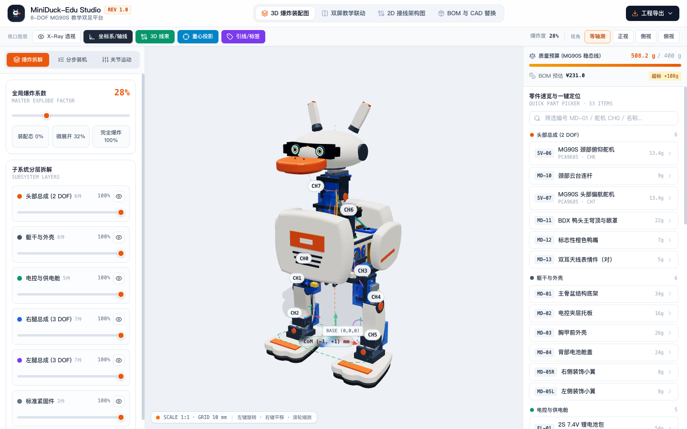
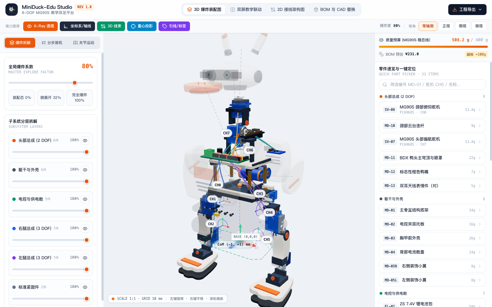
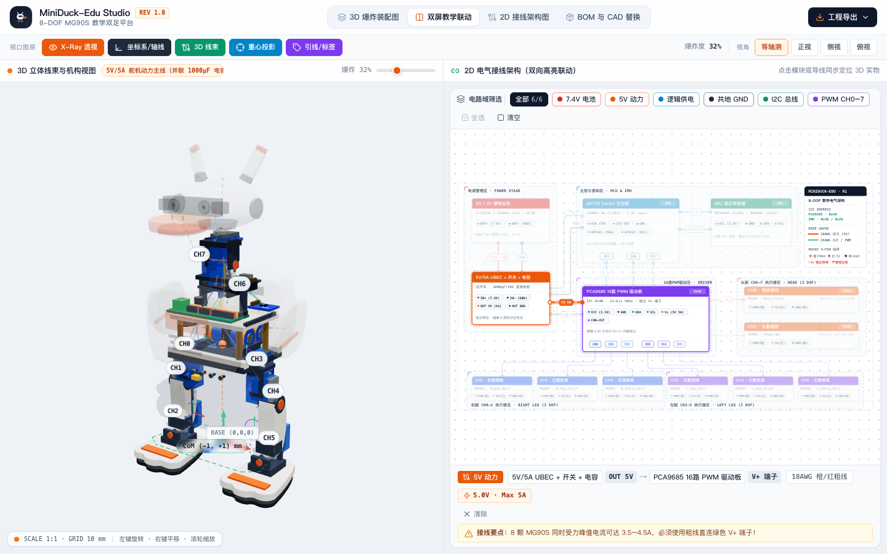
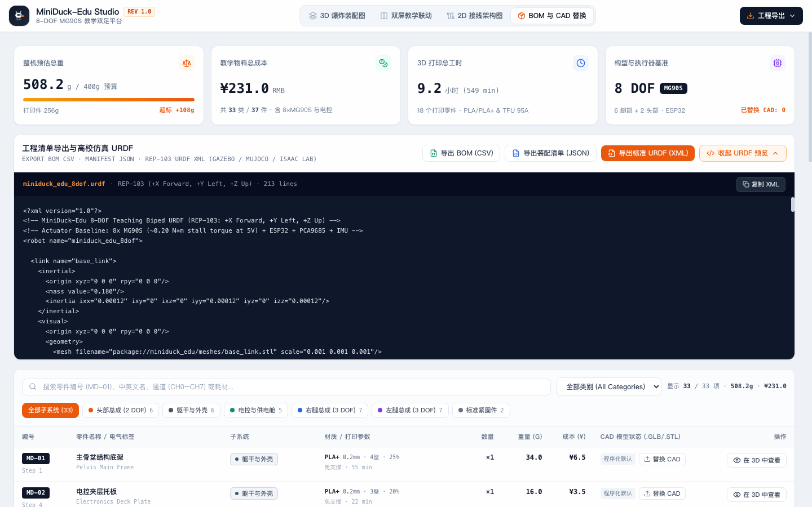

<div align="center">

# MiniDuck-Edu Studio

**Interactive 3D Exploded Assembly, 8-DOF Kinematics & Synchronized 2D/3D Wiring Workbench for an MG90S Bipedal Teaching Robot**

[中文](README.md) | **English**

[](https://swnb.github.io/micro-duck/)
[](https://github.com/swnb/micro-duck/actions/workflows/deploy-pages.yml)
[](docs/architecture.md)
[](docs/hardware-and-wiring.md)

**Live Demo (Zero Install, Offline-Ready):** **[https://swnb.github.io/micro-duck/](https://swnb.github.io/micro-duck/)**

</div>

---

## Overview

**MiniDuck-Edu Studio** is a zero-backend, purely client-side engineering studio built with **React 18, TypeScript (strict), Three.js 0.169 (`@react-three/fiber` + `@react-three/drei`), and Tailwind CSS** for university robotics labs and rapid 3D-printed prototyping.

It models a BDX-inspired **8-DOF MG90S bipedal mini-duck robot** (33 BOM items / 37 pieces, baseline **¥231.0 RMB** / **508.2 g**, with a full lightweighting guide down to **<390 g** for the 400 g MG90S stability budget) from a single typed **Assembly Manifest** (`src/data/robotManifest.ts` & `src/data/wiringData.ts`).

---

## UI Previews

| 3D Exploded Assembly (Default 28%) | 80% Exploded + Live X-Ray Shells |
| :---: | :---: |
|  |  |
| **Dual-Screen 3D ↔ 2D Wiring Sync** | **BOM, URDF Preview & CAD Override Workbench** |
|  |  |

---

## Key Features

- **Interactive 3D Exploded Assembly (`3D 爆炸装配图`)**: Master explode slider (`0%–100%`) plus independent per-subsystem visibility and explode multipliers (`head`, `torso`, `electronics`, `right_leg`, `left_leg`, `hardware`), dashed CAD leader lines, live **X-Ray** translucent shells (`opacity: 0.22`), and smooth camera presets (`Iso`, `Front`, `Side`, `Top`).
- **8-Step Guided Build & Live 8-DOF Kinematics**: Lego-style Steps 1–8 highlighting active parts while ghosting future steps; 5 preset teaching poses (`stand_zero`, `shift_left`, `step_right`, `curious_look`, `pecking`); live floor-projected **Center of Mass (CoM)** with dynamic convex-hull **Support Polygon** stability indicator; RGB local joint frames and clickable `CH0–CH7` badges.
- **Bidirectional 2D/3D Wiring Studio (`双屏教学联动` & `2D 接线架构图`)**: Interactive `1056×584` SVG schematic synchronized with 3D Catmull-Rom harness tubes across 13 modules, 19 wires, and 6 circuit domains (`7.4V`, `5V Servo`, `Logic`, `GND`, `I2C`, `PWM`), paired with an interactive 4-item pre-power **Safety Checklist** (`PCA9685: 0x40`, `MPU6050: 0x68 / BNO055: 0x28`).
- **BOM Workbench, In-Browser CAD Swap & URDF Export (`BOM 与 CAD 替换`)**: Filterable 33-item BOM with cost/weight/print-time KPIs (`549 min ≈ 9.2 h` across 18 printed parts), one-click export to **CSV BOM**, **Manifest JSON**, and **REP-103 URDF XML** (with inline collapsible preview), plus zero-code local **`.glb` / `.stl` CAD replacement** (auto `0.1×` mm-to-cm scale for `.stl`, `1.0×` for `.glb`).

---

## 8-DOF Kinematic Chain & Channel Map

| Channel | Future Bus ID | Joint ID | Subsystem | Axis (REP-103) | Range | Role |
| :---: | :---: | :--- | :--- | :--- | :---: | :--- |
| `CH0` | `10` | `r_hip_roll` | Right Leg (`SV-00`) | `Roll (X_rob)` | `-28° ~ +28°` | Lateral weight shift |
| `CH1` | `11` | `r_hip_pitch` | Right Leg (`SV-01`) | `Pitch (Y_rob)` | `-42° ~ +42°` | Fore/aft leg swing |
| `CH2` | `12` | `r_ankle_roll` | Right Leg (`SV-02`) | `Roll (X_rob)` | `-30° ~ +30°` | Foot-ground leveling |
| `CH3` | `20` | `l_hip_roll` | Left Leg (`SV-03`) | `Roll (X_rob)` | `-28° ~ +28°` | Symmetric lateral shift |
| `CH4` | `21` | `l_hip_pitch` | Left Leg (`SV-04`) | `Pitch (Y_rob)` | `-42° ~ +42°` | Fore/aft swing (`invert = true` in firmware) |
| `CH5` | `22` | `l_ankle_roll` | Left Leg (`SV-05`) | `Roll (X_rob)` | `-30° ~ +30°` | Foot-ground leveling |
| `CH6` | `30` | `neck_pitch` | Head (`SV-06`) | `Pitch (Y_rob)` | `-26° ~ +32°` | Head nod & dynamic CoM trim |
| `CH7` | `31` | `head_yaw` | Head (`SV-07`) | `Yaw (Z_rob)` | `-55° ~ +55°` | Expressive yaw rotation |

> **Power Isolation Baseline:** 2S `7.4V` Li-ion pack → main switch → dedicated `5V/5A` UBEC + `1000µF` bulk cap → PCA9685 `V+` terminal (never power 8 servos from ESP32 `5V`), with star-grounded `GND` and `3.3V` I2C bus (`GPIO21 SDA` / `GPIO22 SCL`).

---

## Documentation Hub

The complete university-grade technical documentation suite is written in Chinese and verified 100% against the codebase:

| Document | Topics Covered |
| :--- | :--- |
| [中文首页 (`README.md`)](README.md) | Full Chinese landing page with previews and project tree |
| [Documentation Hub (`docs/README.md`)](docs/README.md) | Complete index and role-based reading paths (Instructors / Students / CAD Engineers / Developers) |
| [Architecture (`docs/architecture.md`)](docs/architecture.md) | Module dataflow diagram, Assembly Manifest, `1 unit = 10 mm` ↔ REP-103 URDF transform math, 4-view state sync |
| [Hardware & Wiring (`docs/hardware-and-wiring.md`)](docs/hardware-and-wiring.md) | Full 8-DOF map, 33-item BOM (`¥231.0 / 508.2 g`), **<400 g lightweighting plan**, power isolation topology, 19-wire table, 4 safety checks, Feetech bus upgrade path |
| [CAD & 3D Printing (`docs/cad-and-printing-guide.md`)](docs/cad-and-printing-guide.md) | Fusion 360 / SolidWorks / Onshape export specs, 18-part PLA+/TPU print table (`549 min`), browser `.glb`/`.stl` hot-swap & `0.1×` scale rules |
| [Teaching Curriculum (`docs/teaching-curriculum.md`)](docs/teaching-curriculum.md) | 4-session university lab manual (assembly & 90° trim, CoM & support polygon, power isolation & I2C debug, REP-103 URDF simulation) |
| [Development & Deploy (`docs/development-and-deploy.md`)](docs/development-and-deploy.md) | Local dev setup, extending parts/joints/harnesses, GitHub Actions (`deploy-pages.yml`) CI/CD & troubleshooting |

---

## Quick Start & Deployment

Requires **Node.js 22+** and **pnpm 10+**:

```bash
# Install & run local dev server (http://127.0.0.1:5173/)
pnpm install --frozen-lockfile
pnpm dev

# Strict TypeScript check + production build
pnpm build

# Subpath production build matching GitHub Pages
VITE_BASE_PATH="/micro-duck/" pnpm build
pnpm preview
```

Every push to `main` (or manual `workflow_dispatch`) triggers [`.github/workflows/deploy-pages.yml`](.github/workflows/deploy-pages.yml), building with `VITE_BASE_PATH="/${{ github.event.repository.name }}/"` and deploying `dist/` via `actions/deploy-pages@v4` to **[https://swnb.github.io/micro-duck/](https://swnb.github.io/micro-duck/)**.
