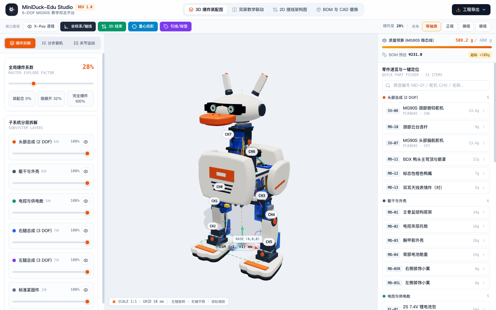
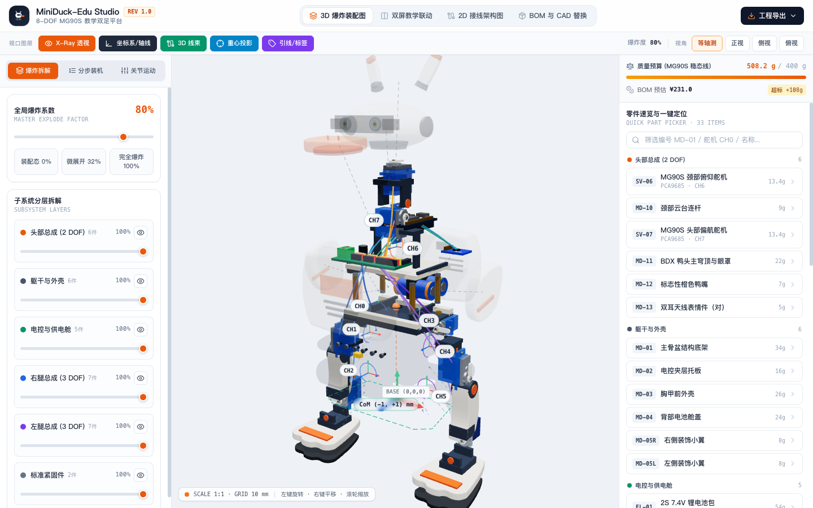
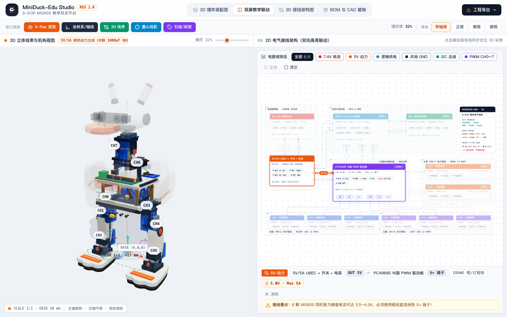
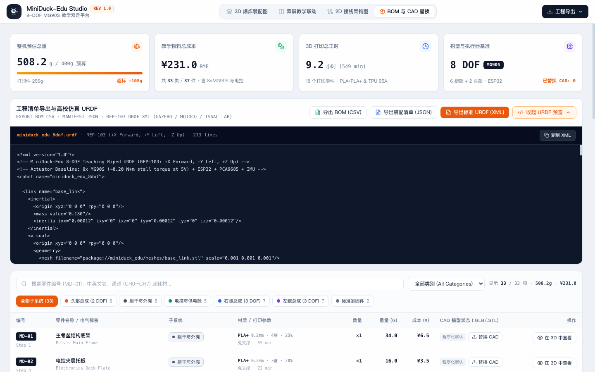

<div align="center">

# MiniDuck-Edu Studio

**8-DOF MG90S 双足教学机器人 · 交互式 3D 爆炸装配、运动学仿真与 2D/3D 机电联动工作台**

**中文** | [English](README.en.md)

[](https://swnb.github.io/micro-duck/)
[](https://github.com/swnb/micro-duck/actions/workflows/deploy-pages.yml)
[](docs/architecture.md)
[](docs/hardware-and-wiring.md)

**在线体验（免安装、开箱即用）：** **[https://swnb.github.io/micro-duck/](https://swnb.github.io/micro-duck/)**

</div>

---

## 项目定位

**MiniDuck-Edu Studio** 是一套面向 **高校机器人课程、机电一体化实验与创客实验室** 的纯前端数字孪生教学工作台，围绕一台 **BDX 仿生小鸭造型、8 自由度（8-DOF）MG90S 驱动、全机参考成本 ¥231.0** 的开源教学双足机器人构建：

- **零后端、100% 离线可运行**：程序化 Swiss-CAD 3D 渲染与 Studio 灯光，不依赖外部 CDN/HDRI，校园内网机房也能秒开。
- **单数据源装配清单（Assembly Manifest）**：全机 **33 项物料（37 件）**、**8 个关节**、**8 步乐高式装机引导**、**13 个电气模块** 与 **19 条导线** 统一驱动 3D 爆炸图、2D 原理图、CoM 质心解算、BOM 核算与 **REP-103 URDF** 导出。
- **支持浏览器内热替换真实 CAD**：师生可直接上传 Fusion 360 / SolidWorks / Onshape 导出的 `.glb` / `.stl` 零件，零代码即时替换并保留爆炸动画、X-Ray 透视与 8-DOF 运动学联动。

---

## 界面预览（4 大核心工作台）

| 3D 爆炸装配图（默认 28% 展示态） | 80% 爆炸拆解 + X-Ray 外壳透视 |
| :---: | :---: |
|  |  |
| **双屏教学联动（3D 线束 ↔ 2D 电气原理图）** | **BOM 核算、URDF 预览与 CAD 热替换工作台** |
|  |  |

---

## 核心功能总览

- **交互式 3D 爆炸装配与分步装机（`3D 爆炸装配图`）**
  - 全局爆炸滑块（`0%–100%` + `装配态 0%` / `微展开 32%` / `完全爆炸 100%` 快捷预设）与 6 大子系统独立显隐、独立拆解倍率。
  - **8 步乐高式装机引导**（Step 1–8）：自动缓动展开至推荐比例、高亮当前步零件、已完成步常亮、后续步半透明虚影，附带紧固件规格与工程要点。
  - **实时 X-Ray 透视**（外壳透明度 `0.22`）、**CAD 虚线引线**、**4 视角相机预设**（`等轴测` / `正视` / `侧视` / `俯视`）。
- **8-DOF 实时正运动学与 CoM 稳定性可视化**
  - 内置 5 组经典教学姿态（`零位站立`、`重心左移`、`抬右腿迈步`、`好奇张望`、`低头巡检`）与 8 路关节滑块（含单轴一键归 90° 中位）。
  - 实时按真实物料质量计算 3D **质心投影（CoM）** 与动态接地脚掌 **凸包支撑多边形（Support Polygon）**，稳定呈翠绿色、倾倒失稳即时转红警示。
  - 叠加世界原点与 8 关节局部 RGB 坐标系、旋转方向弧箭与可点击 `CH0–CH7` 通道徽章。
- **2D ↔ 3D 双屏接线联动与防烧板核查（`双屏教学联动` & `2D 接线架构图`）**
  - 进入双屏模式自动开启 X-Ray 与 3D 立体线束；支持按 **6 大电路域**（`7.4V 电池`、`5V 动力`、`逻辑供电`、`共地 GND`、`I2C 总线`、`PWM CH0–7`）过滤。
  - 2D SVG 原理图与 3D Catmull-Rom 线束双向点击高亮（含脉冲流向球），实时显示引脚映射、推荐线规（`18AWG`/`22AWG`/`26AWG`）与安全警示。
  - 内置可勾选 **4 项上电前防烧板核查清单**、I2C 地址速查（`PCA9685: 0x40`、`MPU6050: 0x68`、`BNO055: 0x28`）与 MG90S 三线色序提示。
- **BOM 核算、热替换 CAD 与仿真导出（`BOM 与 CAD 替换`）**
  - 实时汇总 33 项物料（**¥231.0 RMB** / **508.2 g** 对比 **400 g MG90S 稳态预算** / 打印工时 **9.2 小时**），内置轻量化压进 400 g 预算工程指南。
  - 支持行内或 Inspector 上传 `.glb` / `.stl` 热替换（`.stl` 自动 `0.1×` `mm → cm` 缩放），随时一键恢复默认。
  - 一键导出 **BOM CSV**（含 UTF-8 BOM）、**装配清单 JSON** 以及可直接对接 Gazebo / MuJoCo / Isaac Lab 的 **REP-103 标准 URDF XML**（支持页面内折叠预览与一键复制）。

---

## 8-DOF 通道映射速览表

全机采用 **ESP32 (`GPIO21 SDA / GPIO22 SCL`) → PCA9685 (`I2C 0x40`) → 8 × MG90S (`50Hz PWM, 1500µs 中位`)**，同时为二期升级飞特串行总线舵机（SCS0009 / STS3215）预留了总线 ID：

| PWM 通道 | 预留总线 ID | 关节 ID | 中文名称 | 子系统 | REP-103 轴向 | 软件限位 | 核心运动功能 |
| :---: | :---: | :--- | :--- | :--- | :--- | :---: | :--- |
| `CH0` | `10` | `r_hip_roll` | 右髋侧摆 | 右腿 (`SV-00`) | `Roll (X_rob)` | `-28° ~ +28°` | 单腿支撑重心侧移 |
| `CH1` | `11` | `r_hip_pitch` | 右髋前摆 | 右腿 (`SV-01`) | `Pitch (Y_rob)` | `-42° ~ +42°` | 右腿前后摆动迈步 |
| `CH2` | `12` | `r_ankle_roll` | 右踝侧摆 | 右腿 (`SV-02`) | `Roll (X_rob)` | `-30° ~ +30°` | 与 `CH0` 反向协同保持脚掌贴地 |
| `CH3` | `20` | `l_hip_roll` | 左髋侧摆 | 左腿 (`SV-03`) | `Roll (X_rob)` | `-28° ~ +28°` | 与 `CH0` 对称横向重心控制 |
| `CH4` | `21` | `l_hip_pitch` | 左髋前摆 | 左腿 (`SV-04`) | `Pitch (Y_rob)` | `-42° ~ +42°` | 左腿前后迈步（镜像安装，固件 `invert = true`） |
| `CH5` | `22` | `l_ankle_roll` | 左踝侧摆 | 左腿 (`SV-05`) | `Roll (X_rob)` | `-30° ~ +30°` | 与 `CH3` 反向协同保持左脚贴地 |
| `CH6` | `30` | `neck_pitch` | 颈部俯仰 | 头部 (`SV-06`) | `Pitch (Y_rob)` | `-26° ~ +32°` | 鸭头点头/抬头与动态前后配重 |
| `CH7` | `31` | `head_yaw` | 头部偏航 | 头部 (`SV-07`) | `Yaw (Z_rob)` | `-55° ~ +55°` | 鸭头水平左右顾盼表情控制 |

---

## 项目目录结构

```text
micro-duck/
├── .github/workflows/
│   └── deploy-pages.yml          # GitHub Pages 自动构建与发布工作流
├── docs/                         # 完整工程与高校教学文档体系
│   ├── assets/                   # 4 张实机渲染预览图 (preview-*.png)
│   ├── README.md                 # 文档中心总目录与按角色阅读路线图
│   ├── architecture.md           # 前端架构、单数据源清单与 REP-103 坐标换算
│   ├── hardware-and-wiring.md    # 8-DOF 运动学、33 项 BOM、400g 减重与 19 条接线
│   ├── cad-and-printing-guide.md # CAD 建模规范、18 项打印参数与热替换指南
│   ├── teaching-curriculum.md    # 高校机器人课程 4 课时实验手册与评分量表
│   └── development-and-deploy.md # 本地开发、自定义扩展与 CI/CD 排错指南
├── src/
│   ├── types/robot.ts            # 零件、关节、步骤、线束与 CAD 覆盖强类型定义
│   ├── data/
│   │   ├── robotManifest.ts      # 单数据源：33 零件、8 关节、8 步骤、5 预设姿态
│   │   └── wiringData.ts         # 13 电气节点、19 导线、6 电路域、4 防烧板核查
│   ├── utils/exporters.ts        # BOM CSV / Manifest JSON / REP-103 URDF 导出器
│   ├── components/
│   │   ├── HeaderBar.tsx         # 顶栏 4 视图切换、视口图层开关、相机预设与导出菜单
│   │   ├── scene/                # SceneViewport / DuckAssemblyScene / PartMeshes / CustomCadMesh / WiringHarness3D
│   │   ├── wiring/               # WiringSchematic2D / SafetyChecklist
│   │   └── panels/               # ControlRail / InspectorDrawer / BomWorkbench
│   ├── App.tsx                   # 全局状态中枢、4 视图布局与 SceneErrorBoundary
│   └── main.tsx                  # 应用入口
├── index.html                    # 页面模板与内联 SVG 小鸭图标
├── package.json                  # 依赖与脚本 (React 18 / Three.js 0.169 / Vite 6)
├── vite.config.ts                # 支持 VITE_BASE_PATH 动态子路径配置
├── README.md                     # 中文主文档（本页）
└── README.en.md                  # English Overview
```

---

## 完整文档导航

点击进入对应专题文档（共 6 篇，均与源码实时数据 100% 核对一致）：

| 专题文档 | 内容简介 |
| :--- | :--- |
| **[文档中心与阅读路线图](docs/README.md)** | 全套文档总索引，提供 **高校教师备课 / 学生装机接线 / 机械 CAD 替换 / 二次开发者** 四条角色路线 |
| **[系统架构与数据流](docs/architecture.md)** | 前端模块分层（Mermaid 图）、Assembly Manifest 单数据源、`1 unit = 10 mm` 与 REP-103 URDF 换算公式、4 视图联动与 CoM 算法 |
| **[硬件设计、BOM 核算与电气接线](docs/hardware-and-wiring.md)** | 8-DOF 运动学表、完整 33 项 BOM（¥231.0 / 508.2g）、**压进 MG90S 400g 稳态预算的减重方案**、供电隔离拓扑、19 条接线、4 项防烧板核查与飞特总线升级路径 |
| **[CAD 建模、3D 打印与热替换指南](docs/cad-and-printing-guide.md)** | Fusion 360 / SolidWorks / Onshape 导出规范、18 项打印零件全量切片参数表（549 min ≈ 9.2h）、浏览器热替换 `.glb`/`.stl` 与 `0.1×` 缩放约定 |
| **[高校机器人课程实验手册（4 课时）](docs/teaching-curriculum.md)** | 实验一（拆解与 90° 中位）、实验二（CoM 与支撑多边形）、实验三（供电隔离与 I2C 调试）、实验四（URDF 导出与仿真衔接）及评分量表 |
| **[本地开发、二次扩展与自动部署](docs/development-and-deploy.md)** | Node 22 + pnpm 10 本地开发、扩展零件/关节/线束方法、GitHub Actions (`deploy-pages.yml`) 工作流机制与排错指南 |

---

## 本地开发与 GitHub Pages 自动部署速查

### 本地运行（需 Node.js 22+ 与 pnpm 10+）

```bash
pnpm install --frozen-lockfile
pnpm dev
```

开发服务器默认启动在 `http://127.0.0.1:5173/`。

### 生产构建与子路径预览

```bash
# 默认根路径 ("/") 构建
pnpm build

# GitHub Pages 子路径构建与本地预览
VITE_BASE_PATH="/micro-duck/" pnpm build
pnpm preview
```

### GitHub Pages 自动部署

每次推送至 `main` 分支（或在 Actions 页面手动点击 **Run workflow**）都会自动触发 [`.github/workflows/deploy-pages.yml`](.github/workflows/deploy-pages.yml)，执行严格 TypeScript 检查与 `VITE_BASE_PATH="/${{ github.event.repository.name }}/" pnpm build`，并将 `dist/` 通过官方 `actions/deploy-pages@v4` 发布至 **[https://swnb.github.io/micro-duck/](https://swnb.github.io/micro-duck/)**。Fork 后在仓库 **Settings → Pages → Source** 选择 **GitHub Actions** 即可零配置上线。
