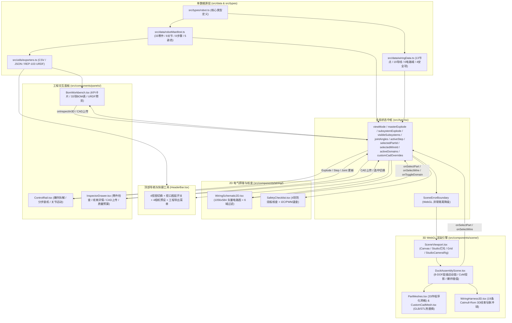

# 系统架构与数据流设计

[← 返回文档中心](README.md) · [返回首页](../README.md)

MiniDuck-Edu Studio 是一个 **100% 纯前端、零后端依赖、完全离线可运行** 的机器人工程教学 Web 应用，基于 React 18、TypeScript 5（严格模式）、Three.js 0.169（`@react-three/fiber` v8 + `@react-three/drei` v9）和 Tailwind CSS v3 构建。

本篇文档详细阐述前端模块分层、单数据源装配清单（Single Source of Truth）设计、Three.js 场景与 REP-103 机器人坐标系换算公式，以及 4 大视图之间的双向状态联动机制。

---

## 1. 前端模块架构与单向数据流

应用采用 **状态集中上提（`App.tsx`）+ 声明式单数据源（`src/data/`）+ 视图解耦渲染** 的分层架构：

### 关键架构设计原则

1. **零外部网络资源依赖（Offline-Ready）**：
   - `SceneViewport.tsx` 使用 `@react-three/drei` 的 `<Environment>` + 4 个程序化 `<Lightformer>` 柔光箱生成 Studio IBL，不请求任何外部 HDRI 文件；
   - 33 个零件默认全部由 `PartMeshes.tsx` 的参数化几何体（`ExtrudeGeometry` / 基础体组合）即时构建，部署到内网或校园局域网机房也能秒开。
2. **WebGL 异常隔离降级**：
   - `App.tsx` 使用 `SceneErrorBoundary` 包裹 `<SceneViewport />`。即使老旧教学机房浏览器禁用硬件加速导致 WebGL 上下文初始化失败，系统也会友好提示并保持 **2D 接线架构图、防烧板清单、BOM 核算与 URDF 导出** 100% 可用。
3. **资源生命周期严格回收**：
   - 上传自定义 `.glb`/`.stl` 创建的 `Blob ObjectURL` 会在替换、移除或组件卸载时通过 `URL.revokeObjectURL` 释放；
   - `CustomCadMesh.tsx`、`WiringHarness3D.tsx`、`DuckAssemblyScene.tsx` 均在 `useEffect` 清理阶段显式调用 `geometry.dispose()` 和 `material.dispose()` 防止显存泄漏。

---

## 2. 单数据源装配清单（Assembly Manifest）设计

整个机器人平台的机械、运动学、成本、打印与电气属性全部收口于 `src/types/robot.ts` 定义的强类型契约，并实例化在两个数据文件中：

| 数据文件 | 导出常量 | 条目数 | 被哪些模块消费 |
| :--- | :--- | :---: | :--- |
| `src/data/robotManifest.ts` | `SUBSYSTEM_META` | 6 个子系统 | `ControlRail`、`InspectorDrawer`、`BomWorkbench`、`DuckAssemblyScene`、`SafetyChecklist` |
| `src/data/robotManifest.ts` | `ROBOT_JOINTS` / `JOINT_BY_ID` | 8 个关节 (`CH0–CH7`) | `ControlRail`、`InspectorDrawer`、`BomWorkbench`、`DuckAssemblyScene`、`SafetyChecklist`、`exporters` |
| `src/data/robotManifest.ts` | `ROBOT_PARTS` / `PART_BY_ID` | 33 项零件（37 件） | `DuckAssemblyScene`、`SceneViewport`、`WiringHarness3D`、`ControlRail`、`InspectorDrawer`、`BomWorkbench`、`exporters` |
| `src/data/robotManifest.ts` | `ASSEMBLY_STEPS` | 8 个装机步骤 | `App`、`ControlRail`、`DuckAssemblyScene` |
| `src/data/robotManifest.ts` | `POSE_PRESETS` / `DEFAULT_JOINT_ANGLES` | 5 组预设姿态 | `App`、`ControlRail`、`DuckAssemblyScene` |
| `src/data/wiringData.ts` | `CIRCUIT_DOMAIN_META` | 6 大电路域 | `WiringSchematic2D`、`InspectorDrawer` |
| `src/data/wiringData.ts` | `WIRING_NODES` | 13 个电气节点 | `WiringSchematic2D`、`WiringHarness3D`、`InspectorDrawer` |
| `src/data/wiringData.ts` | `WIRE_CONNECTIONS` | 19 条物理连线 | `WiringSchematic2D`、`WiringHarness3D`、`InspectorDrawer`、`App` |
| `src/data/wiringData.ts` | `HARDWARE_SAFETY_CHECKS` | 4 项防烧板核查 | `SafetyChecklist` |

通过这种 **Assembly Manifest** 模式，修改任何一个零件的重量、价格、爆炸向量或关节限位，都会同时反映在 **3D 渲染、CoM 质心计算、质量预算条、BOM 表格、CSV/JSON/URDF 导出文件** 中，彻底消除文档、表格与模型参数脱节的问题。

---

## 3. 尺度约定与坐标系换算公式

### 3.1 3D 场景尺度与坐标系（Three.js Right-Handed Y-Up）

在 WebGL 渲染层（`SceneViewport.tsx`、`DuckAssemblyScene.tsx`、`robotManifest.ts`）中采用统一工程尺度：

- **长度单位**：`1 scene unit = 10 mm = 1 cm = 0.01 m`
- **地面参考网格**：`<Grid cellSize={1} sectionSize={5} />` — 每小格 `10 mm`，每主分格 `50 mm`（对应视口左下角图例 `SCALE 1:1 · GRID 10 mm`）
- **轴向定义**：
  - `+X_scene`：机器人左侧（Left）
  - `+Y_scene`：垂直向上（Up，桌面高度 `y = 0`）
  - `+Z_scene`：机器人正前方（Front，鸭嘴朝向）

> 例如标准 MG90S 舵机尺寸 `22.8 × 12.2 × 28.5 mm`，在 Three.js 场景中即为 `2.28 × 1.22 × 2.85` 场景单位；STL 模型通常以毫米（mm）为单位导出，因此 `App.tsx` 上传 `.stl` 时默认应用 `scale = 0.1`（`mm → cm`），而 `.glb` 默认 `scale = 1.0`。

### 3.2 REP-103 机器人坐标系与 URDF 导出换算

ROS / Gazebo / MuJoCo / Isaac Lab 遵循 **REP-103** 右手坐标系（`+X_rob` 朝前、`+Y_rob` 朝左、`+Z_rob` 朝上，单位为米 `m`）。

在 `src/utils/exporters.ts` 的 `generateUrdfXml()` 中，Three.js 场景坐标 $(x_{\text{scene}}, y_{\text{scene}}, z_{\text{scene}})$ 到 REP-103 米制坐标 $(x_{\text{rob}}, y_{\text{rob}}, z_{\text{rob}})$ 的换算公式为：

$$\begin{bmatrix} x_{\text{rob}} \\ y_{\text{rob}} \\ z_{\text{rob}} \end{bmatrix} = 0.01 \cdot \begin{bmatrix} 0 & 0 & 1 \\ 1 & 0 & 0 \\ 0 & 1 & 0 \end{bmatrix} \begin{bmatrix} x_{\text{scene}} \\ y_{\text{scene}} \\ z_{\text{scene}} \end{bmatrix} = \begin{bmatrix} 0.01 \cdot z_{\text{scene}} \\ 0.01 \cdot x_{\text{scene}} \\ 0.01 \cdot y_{\text{scene}} \end{bmatrix}$$

对应各自由度旋转轴映射如下：

| 运动自由度 | 物理含义 | Three.js 轴 `axisThree` | REP-103 轴 `axisRobotics` | 对应通道 |
| :--- | :--- | :---: | :---: | :--- |
| **Roll（侧摆）** | 绕前后轴滚转 | `[0, 0, 1]` (`Z_scene`) | `[1, 0, 0]` (`X_rob`) | `CH0`、`CH2`、`CH3`、`CH5` |
| **Pitch（俯仰）** | 绕左右轴前后摆动 | `[1, 0, 0]` (`X_scene`) | `[0, 1, 0]` (`Y_rob`) | `CH1`、`CH4`、`CH6` |
| **Yaw（偏航）** | 绕竖直轴水平旋转 | `[0, 1, 0]` (`Y_scene`) | `[0, 0, 1]` (`Z_rob`) | `CH7` |

角度限位转换公式：

$$\theta_{\text{rad}} = \theta_{\text{deg}} \times \frac{\pi}{180}$$

> **教学实现说明**：`exporters.ts` 目前直接将 `ROBOT_JOINTS` 中各关节的全局基准枢轴坐标 `pivot` 换算后写入 `<origin xyz="..." />` 作为直观的关节位置参考（同时将 STL 视觉网格缩放设为 `scale="0.001 0.001 0.001"` 以匹配 mm 导出件）。在将其投入 Gazebo / MuJoCo 多体物理仿真时，需将子关节 `<origin>` 转换为相对父关节的增量偏移（详见 [实验四](teaching-curriculum.md#实验四rep-103-urdf-导出与仿真环境衔接)）。

---

## 4. 爆炸算法、层级运动学与 CoM 支撑多边形

### 4.1 连续分层爆炸公式

每个零件在 `DuckAssemblyScene.tsx` 的 `<PartNode>` 中实时计算目标偏移，并通过阻尼插值（`THREE.MathUtils.damp`, 阻尼系数 `10`）平滑过渡：

$$\mathbf{p}_{\text{target}} = \mathbf{p}_{\text{base}} + \left(k_{\text{master}} \cdot k_{\text{subsystem}}\right) \cdot \mathbf{v}_{\text{explode}}$$

- $k_{\text{master}} \in [0, 1]$：全局爆炸系数（初始加载为 `0.28`，便于首屏直观展示内部舵机与骨架）；
- $k_{\text{subsystem}} \in [0, 1]$：6 大子系统各自独立爆炸倍率（默认均为 `1.0`）；
- $\mathbf{v}_{\text{explode}}$：`RobotPartSpec.explodeVector` 中定义的零件径向/轴向拆解向量；
- 当有效展开系数 `explodeFactor > 0.03` 且零件未处于“未来步骤虚影态”时，自动绘制从装配原位指向当前位置的 CAD 虚线引线（Leader Line）。

### 4.2 8-DOF 层级运动链与自动贴地

3D 场景严格按照物理装配父子关系构建三支运动链：

- **右腿链**：`base_link` $\xrightarrow{\text{CH0 } (-Z)}$ `r_hip_u_link` $\xrightarrow{\text{CH1 } (+X)}$ `r_shin_link` $\xrightarrow{\text{CH2 } (-Z)}$ `r_foot_link`
- **左腿链**：`base_link` $\xrightarrow{\text{CH3 } (-Z)}$ `l_hip_u_link` $\xrightarrow{\text{CH4 } (+X)}$ `l_shin_link` $\xrightarrow{\text{CH5 } (-Z)}$ `l_foot_link`
- **头部链**：`base_link` $\xrightarrow{\text{CH6 } (+X)}$ `neck_link` $\xrightarrow{\text{CH7 } (+Y)}$ `head_link`

`evaluateKinematics()` 在每一帧计算左右脚掌 6 个底面特征角点（`FOOT_SOLE_LOCAL_CORNERS`，TPU 底面 `y = -1.85` 局部坐标）的世界坐标最低点 $y_{\min}$，并动态赋予根节点抬升量 $\Delta y = -y_{\min}$，保证无论如何调节髋/踝角度，最低支撑脚始终严密贴合桌面 $y = 0$ 而不会穿模或悬空。

### 4.3 实时质心投影（CoM）与凸包支撑多边形

在 `evaluateKinematics()` 中，系统对全机 33 项物料按真实质量 $m_i = \text{weightGrams}_i \times \text{quantity}_i$ 计算实时加权质心：

$$\mathbf{p}_{\text{CoM}} = \frac{\sum_{i=1}^{33} m_i \cdot \mathbf{T}_{\text{link}(i)} \cdot \mathbf{p}_{\text{local}, i}}{\sum_{i=1}^{33} m_i}$$

随后筛选离地高度差 $< 0.28$ 场景单位（$< 2.8\text{ mm}$）的接地脚掌角点，使用 Andrew 单调链算法（`computeConvexHull2D`）计算地面 `XZ` 平面凸包作为 **静态支撑多边形（Support Polygon）**，并通过 `isPointInConvexPolygon` 判定质心水平投影是否位于支撑多边形内部：
- **落入支撑多边形内部（静态稳定）**：地面圆环与多边形轮廓呈 **翠绿色** (`#059669`)；
- **超出支撑多边形边界（即将倾倒）**：地面圆环与多边形轮廓变为 **警示红色** (`#DC2626`)。

---

## 5. 四大视图模式与双向联动机制

`HeaderBar.tsx` 提供 4 个工作台视图，所有视图共享 `App.tsx` 中的同一份选中状态与数据状态：

| 视图模式 (`viewMode`) | 中文名称 | 布局结构 | 核心联动行为 |
| :--- | :--- | :--- | :--- |
| `explode` | **3D 爆炸装配图** | 左 `ControlRail` (288–304px) + 中 `SceneViewport` + 右 `InspectorDrawer` (320–344px) | 点击 3D 零件或线束同步打开右侧详情；相机目标柔和过渡 48% 朝向选中零件；切换 `分步装机` Step 1–8 时通过 `requestAnimationFrame` 三次缓动（360ms）平滑插值到该步 `recommendedExplode`，当前步骤高亮、已完成步骤正常显示、未装步骤半透明虚影（`opacity: 0.14`）。 |
| `split` | **双屏教学联动** | 左 50% `SceneViewport`（含顶部迷你爆炸滑块）+ 右 50% `WiringSchematic2D` (`compact`) | 首次进入自动开启 `X-Ray 透视`（外壳透明度 `0.22`）与 `3D 线束`（尊重用户后续手动关闭）。点击 2D 模块或导线，3D 中对应零件与 Catmull-Rom 线束立即加粗高亮并启动流向脉冲球；反之亦然。 |
| `wiring` | **2D 接线架构图** | 左自适应 `WiringSchematic2D` + 右 `SafetyChecklist` (356–388px) | 6 大电路域独立过滤开关，底部明细条实时显示起止引脚、推荐线规、电压规格与防烧板安全提示；右侧提供可勾选的 4 项上电前核查清单与 I2C / PWM 速查表。 |
| `bom` | **BOM 与 CAD 替换** | 全宽可滚动 `BomWorkbench`（最大宽 1440px） | 4 张实时 KPI 卡片 + CSV/JSON/URDF 导出栏 + 折叠式 URDF XML 课堂预览 + 可筛选 33 项 BOM 表格；点击任一行 **「在 3D 中查看」** 自动切回 `explode` 视图、确保其子系统可见、退出分步限制并选中聚焦该零件。 |

### 互斥选中策略

在 `App.tsx` 中，`selectedPartId` 与 `selectedWireId` 在非空选中时保持严格互斥：
- `handleSelectPart(partId)`：选中零件时自动清空 `selectedWireId`，并在 2D 原理图和 3D 线束中关联高亮所有 `relatedPartIds` 包含该零件的导线；
- `handleSelectWire(wireId)`：选中导线时自动清空 `selectedPartId`，并在 `InspectorDrawer` 与 2D 底部明细条中展示起止模块、引脚编号及两端器件快捷跳转按钮；
- 点击 3D 空白背景（`onPointerMissed`）或 2D SVG 空白区，同时清空两者回到总览态。
