# 本地开发、二次扩展与自动部署指南

[← 返回文档中心](README.md) · [返回首页](../README.md)

本篇面向前端开发者、高校助教与开源贡献者，介绍如何在本地运行与构建 **MiniDuck-Edu Studio**、如何基于单数据源架构扩展新零件/新线束/新机型，以及 GitHub Actions 自动发布至 GitHub Pages 的完整 CI/CD 机制与排错方法。

---

## 1. 环境准备与本地开发

### 1.1 运行环境要求

- **Node.js**：`22.x`（与 CI 保持一致）
- **pnpm**：`10.x`
- **浏览器**：支持 WebGL 2 的现代桌面浏览器（Chrome / Edge / Safari / Firefox）

### 1.2 快速启动

```bash
# 1. 克隆仓库
git clone https://github.com/swnb/micro-duck.git
cd micro-duck

# 2. 安装依赖（严格锁定 lockfile）
pnpm install --frozen-lockfile

# 3. 启动本地开发服务器
pnpm dev
```

`vite.config.ts` 将开发服务器默认绑定在 `http://127.0.0.1:5173/`（根路径 `/`），支持热更新（HMR）。

### 1.3 类型检查与生产构建

`package.json` 定义了以下脚本：

| 命令 | 实际执行内容 | 用途 |
| :--- | :--- | :--- |
| `pnpm dev` | `vite` | 启动本地热更新开发服务器 (`127.0.0.1:5173`) |
| `pnpm build` | `tsc -b && vite build` | 先运行严格 TypeScript 项目构建检查（含 `noUnusedLocals` / `noUnusedParameters`），再打包输出至 `dist/` |
| `pnpm preview` | `vite preview` | 本地预览 `dist/` 生产产物 |

如需在本地验证与 GitHub Pages 子路径部署完全一致的构建产物：

```bash
VITE_BASE_PATH="/micro-duck/" pnpm build
pnpm preview
```

构建完成后检查 `dist/index.html`，确认静态资源路径均已正确带有 `/micro-duck/assets/...` 前缀。

---

## 2. 二次扩展指南（自定义零件、关节、线束与新机型）

得益于 **Assembly Manifest** 单数据源设计，绝大多数硬件改型（例如增加膝关节扩展为 10-DOF、加装双耳微舵机或超声波传感器、切换为飞特总线舵机架构）只需按如下步骤增量修改，无需重写 UI 逻辑。

### 2.1 新增或修改零件（BOM + 3D 爆炸）

1. **在 `src/data/robotManifest.ts` 的 `ROBOT_PARTS` 中新增 `RobotPartSpec`**：
   - 指定唯一 `id`、工程编号 `code`（如 `MD-14`）、中英文名、`subsystem`、`category`、`quantity`、`unitPriceCny`、`weightGrams`、`explodeVector`、`assemblyStep`、`focusTarget` 与可选 `printSpec`。
   - 完成后 **BOM 表、质量预算、CSV/JSON 导出、快速搜索与 CoM 质心计算会自动生效**。
2. **在 `src/components/scene/PartMeshes.tsx` 中添加程序化网格分支**：
   - 在 `ProceduralPartMesh` 的渲染映射中为新 `partId` 添加 Three.js 几何体，并使用内置的 `<CadMaterial>` 组件以自动获得选中高亮、悬停反馈、`X-Ray` 透明切换与步骤虚影能力。
   - 若该零件属于外部装饰外壳，将其 `id` 加入 `OUTER_SHELL_PART_IDS` 集合即可自动响应 `X-Ray 透视`。
3. **在 `src/components/scene/DuckAssemblyScene.tsx` 中挂载 `<PartNode>`**：
   - 将 `<PartNode partId="your_new_part" basePosition={[x, y, z]} {...sharedPartProps} />` 挂载到对应刚体连杆分组（`base_link` 或某个关节 `<group>`）下，并在 `PART_LINK_MAP` 中登记其所属刚体连杆以参与动态 CoM 计算。

### 2.2 新增或调整关节（运动学 + URDF）

1. 在 `src/types/robot.ts` 的 `JointId` 联合类型中增加新关节标识。
2. 在 `src/data/robotManifest.ts` 中同步更新：
   - `ROBOT_JOINTS`（填入 `channel`、`busIdFuture`、`axisThree`、`axisRobotics`、`pivot`、`minDeg`/`maxDeg`、`parentLink`/`childLink`）；
   - `DEFAULT_JOINT_ANGLES` 与 `POSE_PRESETS` 补齐该关节默认角度。
3. 在 `src/components/scene/DuckAssemblyScene.tsx` 中：
   - 增加对应 `THREE.Group` ref 与 `<JointAxisGizmo>`；
   - 在 `evaluateKinematics()` 和 `useFrame()` 中加入对应旋转矩阵与阻尼插值。
4. `ControlRail.tsx`（关节滑块）、`SafetyChecklist.tsx`（PWM 通道速查表）和 `src/utils/exporters.ts`（REP-103 URDF XML 生成器）都会自动读取 `ROBOT_JOINTS`，无需额外改写。

### 2.3 新增电气模块或导线（2D 原理图 + 3D 线束双向联动）

1. 在 `src/data/wiringData.ts` 的 `WIRING_NODES` 中新增节点（配置 2D SVG `viewBox="0 0 1056 584"` 下的 `x/y/width/height` 与 3D 锚点 `anchor3D`，并通过 `partId` 关联至 `ROBOT_PARTS`）。
2. 在 `WIRE_CONNECTIONS` 中新增导线：
   - 配置 `domain`（6 大电路域之一）、`start2D` / `waypoints2D` / `end2D`（自动生成圆角正交 SVG 路径）以及 `points3D`（自动生成 3D Catmull-Rom `TubeGeometry` 线束并随两端的零件爆炸向量实时形变）；
   - 在 `relatedPartIds` 中列出所有关联零件 ID，即可自动激活 **2D ↔ 3D ↔ Inspector 三方双向高亮**。

### 2.4 将自定义 CAD 固化为仓库默认模型

若团队希望刷新页面后仍默认加载自研 `.glb`/`.stl` 模型（而非临时浏览器上传）：
- 将自研模型放入 `public/models/<filename>.glb`；
- 利用 `import.meta.env.BASE_URL` 拼接路径（保证子路径 GitHub Pages 访问正常），在 `App.tsx` 初始化 `customCadOverrides` 状态或扩展 `CustomCadMesh` 直接加载静态资源路径。

---

## 3. GitHub Actions 自动部署机制（GitHub Pages CI）

本项目采用官方 GitHub Actions Pages 工作流（无需维护独立 `gh-pages` 分支），配置文件位于 [`.github/workflows/deploy-pages.yml`](../.github/workflows/deploy-pages.yml)。

### 3.1 CI/CD 流水线流程图

```mermaid
flowchart LR
  Trigger["触发事件: push main 或 workflow_dispatch"]
  Checkout["actions/checkout@v4"]
  Pnpm["pnpm/action-setup@v4 (v10) + setup-node@v4 (Node 22)"]
  Install["pnpm install --frozen-lockfile"]
  Build["VITE_BASE_PATH=/repo-name/ pnpm build (tsc -b + vite build)"]
  Upload["configure-pages@v5 + upload-pages-artifact@v3 (./dist)"]
  Deploy["actions/deploy-pages@v4 → github-pages 环境"]
  Live["线上访问: https://swnb.github.io/micro-duck/"]

  Trigger --> Checkout --> Pnpm --> Install --> Build --> Upload --> Deploy --> Live
```



### 3.2 关键配置解析

1. **权限最小化与并发保护**：
   - `permissions` 仅申请 `contents: read`、`pages: write`、`id-token: write`（OIDC 令牌部署）；
   - `concurrency: { group: "pages", cancel-in-progress: false }` 确保正在发布的 Pages 部署不会因连续推送而被中途打断。
2. **动态仓库名适配（Fork 零配置即可部署）**：
   - 构建命令使用 `VITE_BASE_PATH="/${{ github.event.repository.name }}/" pnpm build`，配合 `vite.config.ts` 中的 `base: process.env.VITE_BASE_PATH ?? '/'`。
   - 无论你将仓库 Fork 后重命名为什么路径，工作流都会自动匹配对应的子路径前缀，零硬编码修改！
3. **在线体验与仓库设置**：
   - 在 Fork 后的新仓库中，进入 **Settings → Pages → Build and deployment → Source**，选择 **GitHub Actions**，然后推送到 `main` 分支或在 **Actions** 页面手动点击 **Run workflow** 即可完成发布。

---

## 4. 常见开发与部署排错

| 问题现象 | 常见原因 | 解决方案 |
| :--- | :--- | :--- |
| **GitHub Pages 打开白屏，控制台报 JS/CSS 404** | 构建时未传入正确的 `VITE_BASE_PATH` 子路径，或使用了自定义域名但仍带仓库名前缀 | 确认 `deploy-pages.yml` 使用了 `VITE_BASE_PATH="/${{ github.event.repository.name }}/"`；若绑定自定义顶级域名（如 `duck.example.edu`），请将 `VITE_BASE_PATH` 设为 `"/"` |
| **Pages Deploy 作业报 403 / Environment 未启用** | 仓库尚未开启 GitHub Pages 或 Source 仍停留在 `Deploy from a branch` | 在仓库 **Settings → Pages** 中将 Source 切换为 **GitHub Actions**，或使用 CLI 执行 `gh api --method POST repos/<owner>/<repo>/pages -f build_type=workflow` |
| **`pnpm build` 报 `TS6133` 未使用变量错误** | 项目开启了严格 TypeScript (`noUnusedLocals`, `noUnusedParameters`) | 清理未使用的导入与变量，本地运行 `pnpm build` 通过后再提交推送 |
| **部分教学机房打开后 3D 视口提示受限** | 浏览器关闭了硬件加速或 GPU 驱动黑名单拦截 WebGL | 开启浏览器硬件加速，或直接使用已被 `SceneErrorBoundary` 隔离保留的 **2D 接线架构图、防烧板清单与 BOM/URDF 导出** 功能 |
| **更新依赖后 CI `pnpm install --frozen-lockfile` 失败** | 修改了 `package.json` 但未同步提交更新后的 `pnpm-lock.yaml` | 本地重新运行 `pnpm install` 并将 `pnpm-lock.yaml` 一同提交 |
