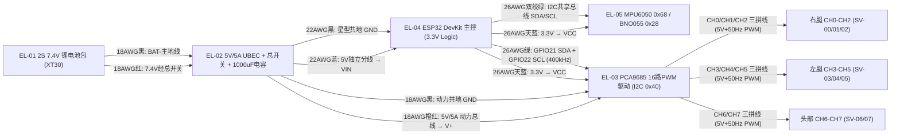

# 硬件设计、BOM 核算与电气接线指南

[← 返回文档中心](README.md) · [返回首页](../README.md)

MiniDuck-Edu 采用面向高校机器人教学优化的 **8-DOF（6 腿部 + 2 头部）MG90S 双足构型**，以 **ESP32 + PCA9685 + MPU6050/BNO055 + 5V/5A 独立 UBEC** 为电控核心。本文档的所有参数、重量、成本、通道与引脚均与源码 `src/data/robotManifest.ts` 和 `src/data/wiringData.ts` 严格一致。

---

## 1. 8-DOF 运动学构型与通道映射（含飞特总线预留 ID）

全机包含 **8 个主动旋转关节**（右腿 3 轴 + 左腿 3 轴 + 头部云台 2 轴），全部挂载于 PCA9685 的 `CH0–CH7`（50Hz PWM，中位脉宽 `1500 µs` 对应机械 90°）。同时为二期升级串行总线舵机预留了 `busIdFuture`（10–31）：

| 通道 | 预留总线 ID | 关节 ID (`JointId`) | 中文名称 | 所属子系统 | 关联舵机编号 | REP-103 旋转轴 | 场景枢轴坐标 (`1 unit = 10 mm`) | 软件限位 | 父连杆 → 子连杆 | 装配与校准要点 |
| :---: | :---: | :--- | :--- | :--- | :---: | :--- | :---: | :---: | :--- | :--- |
| `CH0` | `10` | `r_hip_roll` | 右髋侧摆 | 右腿 | `SV-00` | `Roll (X_rob)` `[1,0,0]` | `[-2.1, 7.6, -0.2]` | `-28° ~ +28°` | `base_link` → `r_hip_u_link` | 站立零位大腿中线垂直地面，用于单腿支撑重心侧移 |
| `CH1` | `11` | `r_hip_pitch` | 右髋前摆 | 右腿 | `SV-01` | `Pitch (Y_rob)` `[0,1,0]` | `[-3.1, 5.6, -0.2]` | `-42° ~ +42°` | `r_hip_u_link` → `r_shin_link` | 正方向向前抬腿，注意前后摆幅避免与躯干下沿干涉 |
| `CH2` | `12` | `r_ankle_roll` | 右踝侧摆 | 右腿 | `SV-02` | `Roll (X_rob)` `[1,0,0]` | `[-3.1, 1.85, 0.1]` | `-30° ~ +30°` | `r_shin_link` → `r_foot_link` | 与 `CH0` 反向协同（$\theta_{\text{ankle}} \approx -\theta_{\text{hip\_roll}}$）保持脚掌贴地 |
| `CH3` | `20` | `l_hip_roll` | 左髋侧摆 | 左腿 | `SV-03` | `Roll (X_rob)` `[1,0,0]` | `[2.1, 7.6, -0.2]` | `-28° ~ +28°` | `base_link` → `l_hip_u_link` | 与右髋对称安装，软件层需核对旋转极性符号 |
| `CH4` | `21` | `l_hip_pitch` | 左髋前摆 | 左腿 | `SV-04` | `Pitch (Y_rob)` `[0,1,0]` | `[3.1, 5.6, -0.2]` | `-42° ~ +42°` | `l_hip_u_link` → `l_shin_link` | 镜像安装于左髋 U 型架，固件中设置 `invert = true` 统一正方向 |
| `CH5` | `22` | `l_ankle_roll` | 左踝侧摆 | 左腿 | `SV-05` | `Roll (X_rob)` `[1,0,0]` | `[3.1, 1.85, 0.1]` | `-30° ~ +30°` | `l_shin_link` → `l_foot_link` | 零位校准务必使左右 TPU 脚垫完全平贴水平桌面 |
| `CH6` | `30` | `neck_pitch` | 颈部俯仰 | 头部 | `SV-06` | `Pitch (Y_rob)` `[0,1,0]` | `[0, 13.7, 0.1]` | `-26° ~ +32°` | `base_link` → `neck_link` | 控制鸭头点头/抬头，可作为动态配重微调前后质心 |
| `CH7` | `31` | `head_yaw` | 头部偏航 | 头部 | `SV-07` | `Yaw (Z_rob)` `[0,0,1]` | `[0, 15.6, 0.3]` | `-55° ~ +55°` | `neck_link` → `head_link` | 顶部水平旋转舵机，装头壳前确保线束留足 ±55° 旋转余量 |

---

## 2. 完整 33 项 BOM 汇总表

### 2.1 分系统与分类统计总览

| 维度 | 分类项 | 物料项数 | 零件总件数 | 合计重量 (g) | 合计成本 (RMB) | 占比（按重量） |
| :--- | :--- | :---: | :---: | :---: | :---: | :---: |
| **按子系统** | 躯干与外壳 (`torso`) | 6 | 6 | 116.0 | ¥25.0 | 22.8% |
| | 电控与供电舱 (`electronics`) | 5 | 5 | 97.0 | ¥79.5 | 19.1% |
| | 右腿总成 (`right_leg`) | 7 | 7 | 86.2 | ¥39.5 | 17.0% |
| | 左腿总成 (`left_leg`) | 7 | 7 | 86.2 | ¥39.5 | 17.0% |
| | 头部总成 (`head`) | 6 | 7 | 74.8 | ¥31.5 | 14.7% |
| | 标准紧固件 (`hardware`) | 2 | 5 | 48.0 | ¥16.0 | 9.4% |
| **按类别** | PLA / PLA+ 打印件 (`3d_print_pla`) | 16 | 17 | 244.0 | ¥55.5 | 48.0% |
| | TPU 95A 柔性件 (`3d_print_tpu`) | 2 | 2 | 12.0 | ¥4.0 | 2.4% |
| | MG90S 舵机 (`actuator`) | 8 | 8 | 107.2 | ¥76.0 | 21.1% |
| | 供电与降压 (`power`) | 2 | 2 | 70.0 | ¥40.0 | 13.8% |
| | 电控模块 (`electronics`) | 3 | 3 | 27.0 | ¥39.5 | 5.3% |
| | 标准紧固件 (`fastener`) | 2 | 5 | 48.0 | ¥16.0 | 9.4% |
| **全机总计** | **全部物料** | **33 项** | **37 件** | **508.2 g** | **¥231.0** | **100.0%** |

### 2.2 全量 33 项物料明细（与 `robotManifest.ts` 100% 对齐）

| # | 编号 | 零件名称 | 英文名 | 子系统 | 类别 | 数量 | 单价 (¥) | 小计 (¥) | 单重 (g) | 总重 (g) | 装机步 | 电气标签 / 规格尺寸 |
| :---: | :---: | :--- | :--- | :--- | :--- | :---: | :---: | :---: | :---: | :---: | :---: | :--- |
| 1 | `MD-01` | 主骨盆结构底架 | Pelvis Main Frame | 躯干 | PLA+ | 1 | 6.5 | 6.5 | 34.0 | 34.0 | Step 1 | `78 × 64 × 24 mm` |
| 2 | `MD-02` | 电控夹层托板 | Electronics Deck Plate | 躯干 | PLA+ | 1 | 3.5 | 3.5 | 16.0 | 16.0 | Step 4 | `72 × 56 × 4 mm` |
| 3 | `MD-03` | 胸甲前外壳 | Front Torso Shell | 躯干 | PLA | 1 | 5.5 | 5.5 | 26.0 | 26.0 | Step 7 | `84 × 32 × 66 mm` |
| 4 | `MD-04` | 背部电池舱盖 | Rear Backpack Shell | 躯干 | PLA | 1 | 5.5 | 5.5 | 24.0 | 24.0 | Step 7 | `84 × 34 × 66 mm` |
| 5 | `MD-05R` | 右侧装饰小翼 | Right Wing Side Panel | 躯干 | PLA | 1 | 2.0 | 2.0 | 8.0 | 8.0 | Step 7 | `14 × 42 × 48 mm` |
| 6 | `MD-05L` | 左侧装饰小翼 | Left Wing Side Panel | 躯干 | PLA | 1 | 2.0 | 2.0 | 8.0 | 8.0 | Step 7 | `14 × 42 × 48 mm` |
| 7 | `EL-01` | 2S 7.4V 锂电池包 | 2S 7.4V Li-ion Pack | 电控 | 供电 | 1 | 26.0 | 26.0 | 54.0 | 54.0 | Step 4 | `7.4V 2S · XT30` |
| 8 | `EL-02` | 5V/5A UBEC 降压 + 滤波电容 | 5V 5A UBEC + 1000µF Cap + Switch | 电控 | 供电 | 1 | 14.0 | 14.0 | 16.0 | 16.0 | Step 4 | `7.4V → 5V 5A` |
| 9 | `EL-03` | PCA9685 16路 PWM 驱动板 | PCA9685 16-Ch I2C PWM Driver | 电控 | 电控 | 1 | 9.5 | 9.5 | 11.0 | 11.0 | Step 5 | `I2C 0x40 · CH0–CH7` |
| 10 | `EL-04` | ESP32 主控开发板 | ESP32 DevKitC / S3 Controller | 电控 | 电控 | 1 | 22.0 | 22.0 | 12.0 | 12.0 | Step 5 | `ESP32 · 3.3V Logic` |
| 11 | `EL-05` | MPU6050 / BNO055 姿态传感器 | 6/9-Axis IMU Module | 电控 | 电控 | 1 | 8.0 | 8.0 | 4.0 | 4.0 | Step 5 | `I2C 0x68 / 0x28` |
| 12 | `SV-00` | MG90S 右髋侧摆舵机 | MG90S Servo (R_Hip_Roll) | 右腿 | 舵机 | 1 | 9.5 | 9.5 | 13.4 | 13.4 | Step 1 | `PCA9685 · CH0` |
| 13 | `MD-06R` | 右髋 U 型过渡支架 | Right Hip U-Bracket | 右腿 | PLA+ | 1 | 2.5 | 2.5 | 11.0 | 11.0 | Step 2 | `34 × 28 × 32 mm` |
| 14 | `SV-01` | MG90S 右髋前摆舵机 | MG90S Servo (R_Hip_Pitch) | 右腿 | 舵机 | 1 | 9.5 | 9.5 | 13.4 | 13.4 | Step 2 | `PCA9685 · CH1` |
| 15 | `MD-07R` | 右小腿仿生连杆 | Right Avian Shin Link | 右腿 | PLA+ | 1 | 3.0 | 3.0 | 14.0 | 14.0 | Step 2 | `24 × 26 × 48 mm` |
| 16 | `SV-02` | MG90S 右踝侧摆舵机 | MG90S Servo (R_Ankle_Roll) | 右腿 | 舵机 | 1 | 9.5 | 9.5 | 13.4 | 13.4 | Step 3 | `PCA9685 · CH2` |
| 17 | `MD-08R` | 右鸭掌骨架 | Right Duck Foot Plate | 右腿 | PLA+ | 1 | 3.5 | 3.5 | 15.0 | 15.0 | Step 3 | `48 × 70 × 16 mm` |
| 18 | `MD-09R` | 右脚 TPU 防滑底垫 | Right TPU Anti-Slip Sole | 右腿 | TPU 95A | 1 | 2.0 | 2.0 | 6.0 | 6.0 | Step 3 | `46 × 68 × 3.5 mm` |
| 19 | `SV-03` | MG90S 左髋侧摆舵机 | MG90S Servo (L_Hip_Roll) | 左腿 | 舵机 | 1 | 9.5 | 9.5 | 13.4 | 13.4 | Step 1 | `PCA9685 · CH3` |
| 20 | `MD-06L` | 左髋 U 型过渡支架 | Left Hip U-Bracket | 左腿 | PLA+ | 1 | 2.5 | 2.5 | 11.0 | 11.0 | Step 2 | `34 × 28 × 32 mm` |
| 21 | `SV-04` | MG90S 左髋前摆舵机 | MG90S Servo (L_Hip_Pitch) | 左腿 | 舵机 | 1 | 9.5 | 9.5 | 13.4 | 13.4 | Step 2 | `PCA9685 · CH4` |
| 22 | `MD-07L` | 左小腿仿生连杆 | Left Avian Shin Link | 左腿 | PLA+ | 1 | 3.0 | 3.0 | 14.0 | 14.0 | Step 2 | `24 × 26 × 48 mm` |
| 23 | `SV-05` | MG90S 左踝侧摆舵机 | MG90S Servo (L_Ankle_Roll) | 左腿 | 舵机 | 1 | 9.5 | 9.5 | 13.4 | 13.4 | Step 3 | `PCA9685 · CH5` |
| 24 | `MD-08L` | 左鸭掌骨架 | Left Duck Foot Plate | 左腿 | PLA+ | 1 | 3.5 | 3.5 | 15.0 | 15.0 | Step 3 | `48 × 70 × 16 mm` |
| 25 | `MD-09L` | 左脚 TPU 防滑底垫 | Left TPU Anti-Slip Sole | 左腿 | TPU 95A | 1 | 2.0 | 2.0 | 6.0 | 6.0 | Step 3 | `46 × 68 × 3.5 mm` |
| 26 | `SV-06` | MG90S 颈部俯仰舵机 | MG90S Servo (Neck_Pitch) | 头部 | 舵机 | 1 | 9.5 | 9.5 | 13.4 | 13.4 | Step 6 | `PCA9685 · CH6` |
| 27 | `MD-10` | 颈部云台连杆 | Neck Pan-Tilt Gimbal | 头部 | PLA+ | 1 | 2.0 | 2.0 | 9.0 | 9.0 | Step 6 | `30 × 26 × 28 mm` |
| 28 | `SV-07` | MG90S 头部偏航舵机 | MG90S Servo (Head_Yaw) | 头部 | 舵机 | 1 | 9.5 | 9.5 | 13.4 | 13.4 | Step 6 | `PCA9685 · CH7` |
| 29 | `MD-11` | BDX 鸭头主穹顶与眼罩 | Duck Head Dome & Visor | 头部 | PLA | 1 | 5.5 | 5.5 | 22.0 | 22.0 | Step 8 | `76 × 72 × 36 mm` |
| 30 | `MD-12` | 标志性橙色鸭嘴 | Signal-Orange Duck Bill | 头部 | PLA | 1 | 2.0 | 2.0 | 7.0 | 7.0 | Step 8 | `42 × 28 × 14 mm` |
| 31 | `MD-13` | 双耳天线表情件（对） | Twin BDX Ear Antennas | 头部 | PLA | 2 | 1.5 | 3.0 | 5.0 | 10.0 | Step 8 | `10 × 12 × 32 mm` |
| 32 | `HW-01` | M3×22mm 六角铜柱（4 根） | M3×22mm Brass Hex Standoffs | 紧固件 | 紧固件 | 4 | 1.0 | 4.0 | 8.0 | 32.0 | Step 4 | `M3 × 22 mm (×4)` |
| 33 | `HW-02` | M2/M2.5/M3 螺丝与杜邦线束包 | Fasteners, Wires & XT30 Kit | 紧固件 | 紧固件 | 1 | 12.0 | 12.0 | 16.0 | 16.0 | Step 7 | `M2×8(24) / M2.5×8(12) / 18+26AWG` |
| — | **合计** | **33 类物料** | **37 件总计** | — | — | **37** | — | **¥231.0** | — | **508.2** | — | **打印件 18 项 (256.0 g / 549 min)** |

---

## 3. 工程专题：如何将整机减重压进 MG90S 400g 稳态预算

在平台的 **InspectorDrawer** 和 **BomWorkbench** 中，系统特意设置了 **400 g（MG90S 稳态线）** 质量预算警示条——当前保守全装版清单总重 **508.2 g（超标 +108.2 g）**，系统会主动标橙提示。为什么必须重视 400 g 预算线？

### 3.1 MG90S 动力学力矩核算

- **标称堵转扭矩（5V）**：约 `2.0 kg·cm ≈ 0.196 N·m`（受国产批次与金属齿轮间隙影响，安全持续保持扭矩应控制在堵转值的 **35%–45%**，即 **`0.07–0.09 N·m`**）。
- **单脚支撑工况**：当右腿抬起、左腿单脚支撑时，左踝（`CH5`）与左髋侧摆（`CH3`）承受的最大静态力臂约 $d \approx 31\text{ mm} = 0.031\text{ m}$。
  - 在整机 **508 g** 满载下，静力矩已达 $0.508 \times 9.81 \times 0.031 \approx 0.154\text{ N·m}$，叠加迈步加速度冲击后极易接近堵转区，导致舵机发热、抖动甚至扫齿；
  - 当整机压降至 **380–400 g** 时，静态支撑力矩降至约 `0.115–0.122 N·m`（且借助重心向支撑脚侧移 `shift_left` 缩短力臂至 `<18 mm` 后，实际维持力矩 `< 0.07 N·m`），可长期稳定连续行走。

### 3.2 六步工程减重方案（实操可减 119–130 g）

无需更改任何核心机械接口，即可将总重从 **508.2 g** 精准压降至 **378–389 g**：

| 优化项 | 涉及物料编号 | 原始重量 | 轻量化改造措施 | 预计减重 |
| :--- | :--- | :---: | :--- | :---: |
| **1. 铜柱改尼龙柱** | `HW-01` | 32.0 g | 将 4 根 M3×22mm 实心黄铜柱替换为高强度 **尼龙六角隔离柱**（4×1.2g ≈ 4.8g），兼得绝缘防短路优势 | **-27.2 g** |
| **2. 锂电池换轻量化航模软包** | `EL-01` | 54.0 g | 将 2×18350/18650 柱状包换为 **2S 450–550mAh 30C 软包锂电**（约 28–30g），放电能力仍 >13A 远超 4.5A 峰值 | **-24.0 g** |
| **3. 躯干装饰壳薄壁/镂空** | `MD-03` / `MD-04` / `MD-05R,L` | 66.0 g | 改为 1.2mm 薄壁 + 8% Gyroid 填充 + 蜂窝散热镂空（压至 ~34g）；或在课堂调试期先拆除外壳跑“裸骨模式”（立减 66g） | **-32.0 g** *(裸骨 -66g)* |
| **4. 头部顶壳极简减重** | `MD-11` / `MD-12` / `MD-13` | 39.0 g | 头部位于最高力臂处（$y \approx 170\text{ mm}$），采用 0.8mm 双壁 + 5% Lightning 闪电填充（`MD-13` 改 2g/支），显著降低整机 CoM 高度 | **-17.0 g** |
| **5. 骨架非承力区掏空** | `MD-01` / `MD-02` / `MD-08R,L` | 80.0 g | 保留螺丝孔周围 4 层壁厚，中间区域改 15% Gyroid + 减重窗，减重同时保持抗扭刚性 | **-15.0 g** |
| **6. 线束裁剪与尼龙螺钉** | `HW-02` | 16.0 g | 裁剪多余舵机线长度、PCB 固定改用 M2.5 尼龙螺丝 | **-6.0 g** |
| **改造后整机总重** | — | **508.2 g** | **完整保留全套 BDX 外观壳体时约 `387.0 g`（调试裸骨态 `~353 g`）** | **累计 -121.2 g** |

---

## 4. 供电隔离与 I2C 总线拓扑

MiniDuck-Edu 的核心电控教学设计在于 **“动力电与逻辑电严格分路 + 星型共地”**，彻底杜绝高校课堂最常见的“8 舵机同时上电拉垮主控导致 ESP32 反复重启或烧毁稳压芯片”问题。

### I2C 总线设备地址速查（ESP32 `GPIO21 = SDA`, `GPIO22 = SCL`）

| 设备模块 | 功能角色 | 默认 I2C 地址 | 供电需求 | 硬件跳线与说明 |
| :--- | :--- | :---: | :--- | :--- |
| **PCA9685** (`EL-03`) | 16 路 12-bit PWM 驱动 | **`0x40`** | `3.3V VCC`（逻辑） + `5V V+`（舵机动力） | A0–A5 焊盘默认全部接地；逻辑侧接 `3.3V` 即可与 ESP32 电平原生兼容，无需电平转换 |
| **MPU6050** (`EL-05` 标配) | 6 轴加速度计 + 陀螺仪 | **`0x68`** | `3.3V Logic` | `AD0` 接地为 `0x68`（接高电平为 `0x69`），与 `0x40` 无地址冲突 |
| **BNO055** (`EL-05` 升级) | 9 轴硬件融合绝对姿态 IMU | **`0x28`** | `3.3V Logic` | 可直接原位替换 MPU6050，内置四元数与欧拉角解算 |

---

## 5. 完整 19 条接线明细表

以下 19 条连线与 `src/data/wiringData.ts` (`WIRE_CONNECTIONS`) 一一对应，涵盖 6 大电路域（`7.4V 电池`: 1 条、`5V 动力`: 1 条、`逻辑供电`: 3 条、`共地 GND`: 3 条、`I2C 总线`: 3 条、`PWM CH0–7`: 8 条）：

| # | 导线 ID | 电路域 | 起点模块 (引脚) | 终点模块 (引脚) | 推荐线规与线色 | 电压 / 信号规格 | 安全与布线说明 |
| :---: | :--- | :--- | :--- | :--- | :--- | :--- | :--- |
| 1 | `wire_bat_pos` | `7.4V 电池` | 2S 锂电池 (`BAT+`) | 5V/5A UBEC (`IN+`) | 18AWG 硅胶红线 | `7.4V DC (2S)` | **务必串接 5A 船型总开关或自恢复保险丝**，便于紧急断电 |
| 2 | `wire_bat_gnd` | `共地 GND` | 2S 锂电池 (`BAT-`) | 5V/5A UBEC (`IN-`) | 18AWG 硅胶黑线 | `0V GND` | 电池负极主地线 |
| 3 | `wire_ubec_pca_vplus` | `5V 动力` | 5V/5A UBEC (`OUT 5V`) | PCA9685 (`V+ 端子`) | 18AWG 橙/红粗线 | `5.0V · Max 5A` | 并联 `1000µF/10V` 电解电容，直连绿色 `V+` 螺丝端子 |
| 4 | `wire_ubec_pca_gnd` | `共地 GND` | 5V/5A UBEC (`OUT GND`) | PCA9685 (`GND 端子`) | 18AWG 黑线 | `0V GND` | 舵机大电流动力回路返回地 |
| 5 | `wire_ubec_esp_vin` | `逻辑供电` | 5V/5A UBEC (`OUT 5V`) | ESP32 (`VIN (5V)`) | 22AWG 蓝线 | `5.0V → 板载 3.3V LDO` | 独立分线；**插 USB-C 烧录时建议先关总电源开关**防倒灌 |
| 6 | `wire_esp_gnd_star` | `共地 GND` | 5V/5A UBEC (`OUT GND`) | ESP32 (`GND`) | 22AWG 黑线 | `0V GND` | 星型共地线，避免舵机大电流地弹干扰主控（IMU 与 PCA9685 逻辑 GND 同步共地） |
| 7 | `wire_esp_pca_3v3` | `逻辑供电` | ESP32 (`3V3 OUT`) | PCA9685 (`VCC (3.3V)`) | 26AWG 天蓝杜邦线 | `3.3V Logic (<15mA)` | 使 PCA9685 I2C 电平与 ESP32 3.3V 严格匹配 |
| 8 | `wire_esp_imu_3v3` | `逻辑供电` | ESP32 (`3V3 OUT`) | IMU (`VCC (3.3V)`) | 26AWG 天蓝杜邦线 | `3.3V Logic` | 为姿态传感器提供低纹波 3.3V 逻辑供电 |
| 9 | `wire_i2c_pca_sda` | `I2C 总线` | ESP32 (`GPIO21 (SDA)`) | PCA9685 (`SDA`) | 26AWG 绿色杜邦线 | `3.3V I2C 400kHz` | I2C 数据线 → `0x40` |
| 10 | `wire_i2c_pca_scl` | `I2C 总线` | ESP32 (`GPIO22 (SCL)`) | PCA9685 (`SCL`) | 26AWG 青绿杜邦线 | `3.3V I2C 400kHz` | I2C 时钟线 → `0x40` |
| 11 | `wire_i2c_imu_bus` | `I2C 总线` | ESP32 (`GPIO21/22`) | IMU (`SDA / SCL`) | 26AWG 双绞绿线 | `3.3V I2C 400kHz` | 与 PCA9685 共享总线，上电用 `i2c_scanner` 验双地址 |
| 12 | `wire_pwm_ch0` | `PWM CH0–7` | PCA9685 (`CH0`) | `SV-00` 右髋侧摆 (`3-Pin`) | 26AWG 3-Pin 排线 | `5V + 50Hz PWM` | MG90S 线序：橙=PWM / 红=5V / 棕=GND |
| 13 | `wire_pwm_ch1` | `PWM CH0–7` | PCA9685 (`CH1`) | `SV-01` 右髋前摆 (`3-Pin`) | 26AWG 3-Pin 排线 | `5V + 50Hz PWM` | 经骨盆过线孔接入 |
| 14 | `wire_pwm_ch2` | `PWM CH0–7` | PCA9685 (`CH2`) | `SV-02` 右踝侧摆 (`3-Pin`) | 26AWG 3-Pin（含 15cm 延长线） | `5V + 50Hz PWM` | 沿小腿内侧走线槽穿行，髋/踝转轴处留半圆弯折余量 |
| 15 | `wire_pwm_ch3` | `PWM CH0–7` | PCA9685 (`CH3`) | `SV-03` 左髋侧摆 (`3-Pin`) | 26AWG 3-Pin 排线 | `5V + 50Hz PWM` | 与 `CH0` 对称走线 |
| 16 | `wire_pwm_ch4` | `PWM CH0–7` | PCA9685 (`CH4`) | `SV-04` 左髋前摆 (`3-Pin`) | 26AWG 3-Pin 排线 | `5V + 50Hz PWM` | 镜像安装，注意固件 `invert = true` |
| 17 | `wire_pwm_ch5` | `PWM CH0–7` | PCA9685 (`CH5`) | `SV-05` 左踝侧摆 (`3-Pin`) | 26AWG 3-Pin（含 15cm 延长线） | `5V + 50Hz PWM` | 沿左小腿线槽隐藏走线并留活动余量 |
| 18 | `wire_pwm_ch6` | `PWM CH0–7` | PCA9685 (`CH6`) | `SV-06` 颈部俯仰 (`3-Pin`) | 26AWG 3-Pin 排线 | `5V + 50Hz PWM` | 经电控夹层顶孔引至颈部底轴 |
| 19 | `wire_pwm_ch7` | `PWM CH0–7` | PCA9685 (`CH7`) | `SV-07` 头部偏航 (`3-Pin`) | 26AWG 3-Pin 排线 | `5V + 50Hz PWM` | **穿过颈部中心留 25mm 柔线松弛度**，防 ±55° 转头拉断 |

> **排针极性提示（防反插）**：MG90S 三线标准色序为 **橙（信号 PWM / 对应 PCA9685 `PWM` 黄针）**、**红（5V 动力 / 中间 `V+` 红针）**、**棕（地线 GND / 外侧黑针）**。PCA9685 排针插反通常不会立即烧毁舵机（因中间引脚恒为 5V），但会导致无动作，务必在通电前目视对齐色标。

---

## 6. 上电前 4 项防烧板核查表（Mandatory Pre-Power Checklist）

对应平台 `2D 接线架构图` 视图右侧 `SafetyChecklist` 中的 4 项硬性检查：

1. **[严禁 · CRITICAL] 严禁从 ESP32 5V 引脚直接给 8 颗舵机供电**
   - 8 颗 MG90S 堵转峰值电流可达 `3.5–4.5 A`，必须由独立 `5V/5A UBEC` 直连 PCA9685 绿色 `V+` 端子，否则会烧毁 ESP32 保护二极管/稳压器或导致主控不断掉电复位。
2. **[严禁 · CRITICAL] 电源、驱动板、主控必须星型共地（Common GND）**
   - 若 UBEC 输出 `GND` 与 ESP32 `GND`、PCA9685 `GND` 未连通，I2C 与 PWM 信号参考电位悬空，舵机会剧烈抽搐抖动。上电前先用万用表蜂鸣档确认三者地线导通且 `V+` 与 `GND` 间无短路。
3. **[建议 · WARNING] 在 PCA9685 `V+` 并联 `1000µF/10V` 电解电容**
   - 双足步行切换支撑脚瞬间电流阶跃极大，在 PCA9685 板载电容焊盘加焊 `1000µF/10V` 电解电容（注意长脚正极 `+` / 白边负极 `-` 切勿反接！）可有效吸收电压毛刺。
4. **[校准 · INFO] 机械装舵盘前务必先通电回 90° 中位**
   - 所有 8 颗 MG90S 在拧紧舵盘螺钉前，必须先运行回中脚本将 `CH0–CH7` 全部输出 `1500 µs`（90° 机械中位），防止首次通电打齿或顶碎 3D 打印 U 型支架。

---

## 7. 开源生态参考与高阶升级路径

MiniDuck-Edu 的教学架构借鉴并兼容主流开源双足机器人研究生态（如 **Disney BDX** 仿生鸭造型美学与 **Open Duck Mini** 社区轻量化 TPU 脚垫、低重心电池仓设计理念），并从一开始就在数据结构中预留了平滑升级路径：

| 演进阶段 | 阶段一：本科教学入门版（当前基线） | 阶段二：闭环控制进阶版 | 阶段三：RL 强化学习科研版 |
| :--- | :--- | :--- | :--- |
| **执行器** | 8 × **MG90S**（开环 50Hz PWM，无位置回读） | 8–10 × **飞特 SCS0009** 串行总线舵机（支持角度/负载/温度回读，沿用预留 `busIdFuture: 10–31`） | 10–14 × **飞特 STS3215** 磁编码总线舵机（360° 绝对编码、30 kg·cm 级扭矩，可扩展膝关节与可动双耳） |
| **驱动通信** | ESP32 → I2C (`0x40`) → PCA9685 PWM | ESP32 半双工 UART → 飞特串口舵机驱动板（单线菊花链大幅精简腿部线束） | Raspberry Pi Zero 2W / Jetson Orin Nano + USB-to-TTL 总线控制器 |
| **姿态感知** | MPU6050 (`0x68`) 6 轴互补滤波 | 升级 **BNO055** (`0x28`) 9 轴硬件融合绝对姿态 | 高频 200Hz IMU（BMI088 / BNO085）+ 足底接触开关/压力传感器 |
| **控制算法** | 离线关键帧步态插值 + CoM 静态稳定判据 + IMU 防倾倒 PD 补偿 | 逆运动学（IK）+ 零力矩点（ZMP）闭环步行 | 使用本平台导出的 **REP-103 URDF** 接入 **MuJoCo / Isaac Lab** 进行 Sim-to-Real 强化学习（PPO）策略训练与真机部署 |
